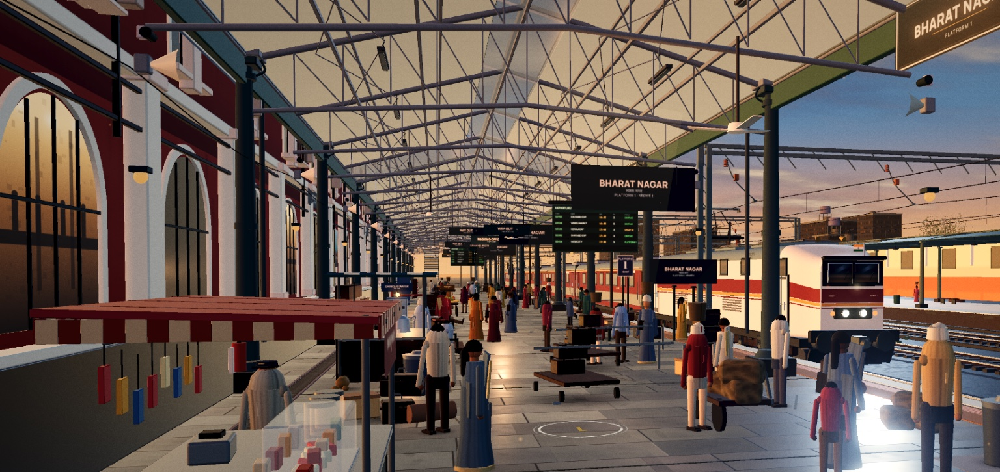
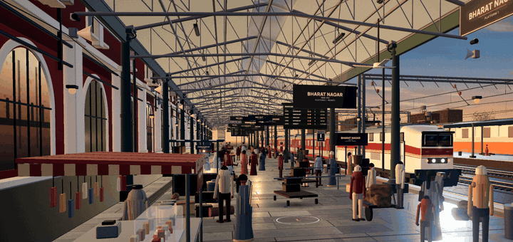
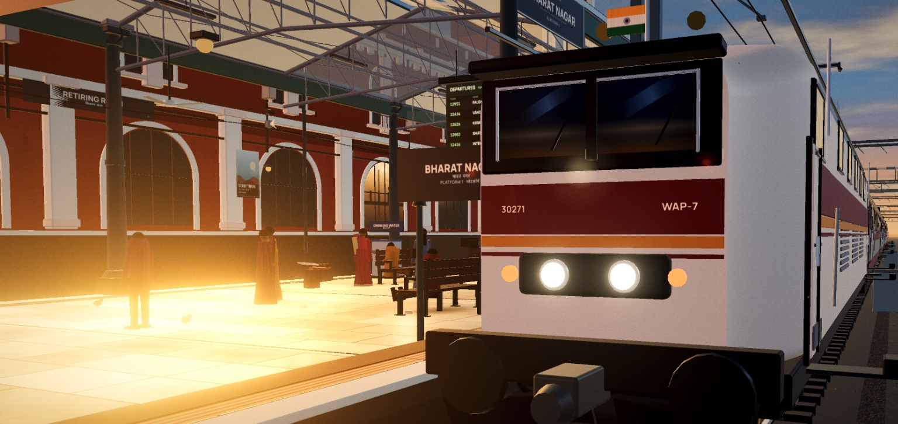
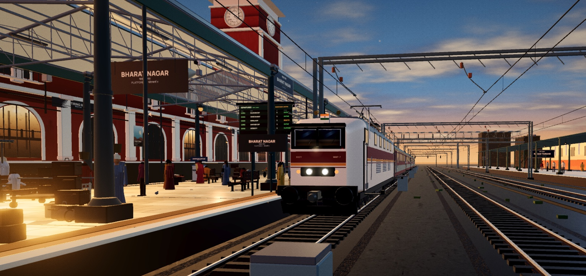
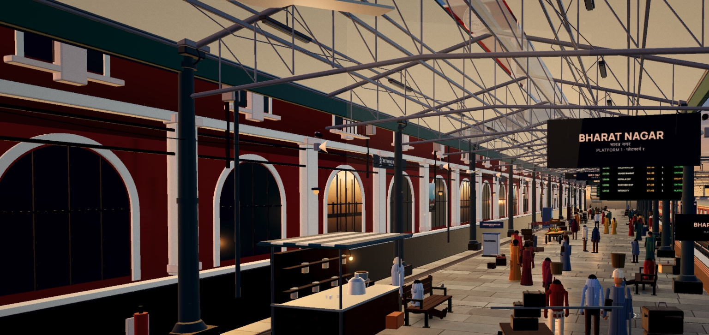
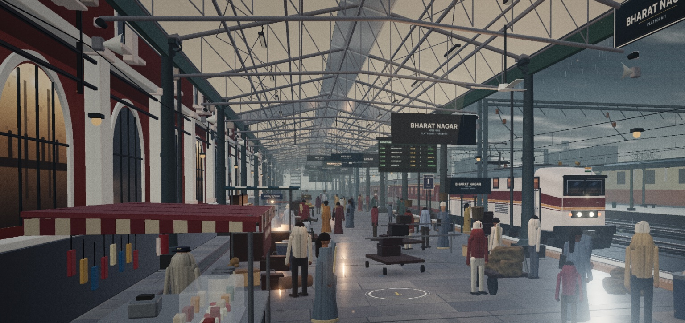
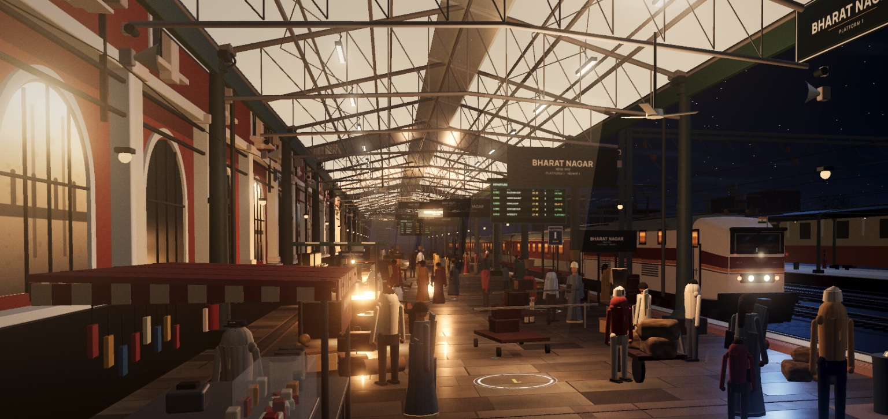

<div align="center">



# Rail Darshan

**Indian Railways, rebuilt in the browser — 2.5 million triangles at 60 fps.**

[](https://threejs.org)
[](#)
[](https://vite.dev)
[](#performance)
[](LICENSE)

[**Live site**](https://abhinav-prabhakar.github.io/RailDarshan/) · [Run it](#run-it) · [Numbers](#numbers) · [Controls](#controls)

</div>



---

<p align="center">
  
  
</p>

<p align="center">
  
  
</p>



---

## What this is

A real-time portrait of an Indian railway station: **15 trains**, **14 coach interiors**, **5 kinds of light**, a fictional station called **Bharat Nagar**, and a live Web Audio soundscape. Locomotives, carriages, the platform, crowd, track and signage are all generated in code, then dressed with photographed PBR textures, captured HDRIs and canvas lettering.

| | |
| --- | --- |
| **Trains** | Rajdhani · Vande Bharat · Shatabdi · Tejas · Duronto · Garib Rath · Golden Temple Mail · Maharajas' Express · Amrit Bharat · Double Decker · Mumbai EMU · WP steam · Namo Bharat · Humsafar · Kalka–Shimla Queen |
| **Interiors** | Chair cars, 2AC/3AC sleepers, EMU second class, a Maharajas' suite, a colonial parlour — each with its own palette, berths, passengers and window |
| **Light** | Golden hour · High noon · Blue hour · Night · Monsoon — sky shader, sun, HDRI, exposure, fog, bloom, lamps, rain |
| **Sound** | Synthesised station ambience, announcements, rail clacks, the WAP-7 twin-tone horn and boarding chimes |

## Under the hood

- **One material, many props.** Static geometry is merged into a handful of vertex-coloured batches — the whole station draws in ~430 calls, not 3,800.
- **Eleven lights, not fifty.** Three warm practicals per bay, emissive bulbs and baked floor pools replace a forest of point lights; one 2048² shadow map stops updating after the third frame.
- **Textures are painted, not fetched.** Stone slabs, tactile paving, jute, soot, signage and posters are drawn to canvas at boot; HDRIs do the lighting.
- **Post that pays for itself.** Half-resolution bloom, a single-fetch grade, adaptive resolution, GTAO reserved for *cinematic*.

## Numbers

| Metric | Value |
| --- | --- |
| Draw calls | **~430** |
| Triangles | **2.5 M** |
| Textures | **127** |
| Lights | **11** |
| Shadow map | 2048², frozen after frame 3 |
| Payload | ~45 MB of HDRIs + PBR |
| Frame budget | 16.7 ms — the scene renders in ~3 |

## Run it

```bash
npm install
npm run dev          # http://localhost:5173
npm run build        # dist/
npm run build:pages  # docs/ for GitHub Pages
```

## Controls

| Input | Action |
| --- | --- |
| Drag / scroll | Orbit / zoom |
| `←` `→` | Previous / next train |
| `1` `2` | Platform / interior |
| `M` | Cycle the light |
| `H` | Sound the horn |
| `S` | Toggle sound |
| `Esc` | Close About |

<div align="center">
<sub>A personal study. Bharat Nagar, its emblem and its liveries are fictional. Not affiliated with Indian Railways.<br/>Built with Three.js, Vite and an unreasonable amount of tea.</sub>
</div>
